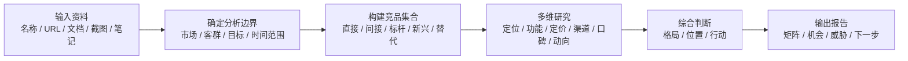

# 竞品分析 Skill

<p align="center">
  
  
  
</p>

<p align="center">
  把零散的公司、产品、市场、项目资料，整理成结构化、可决策、可行动的竞品分析报告。
</p>

---

## 这个 Skill 适合做什么

`competitor-analysis` 是一个面向 Codex 的中文竞品分析 skill。它适合用于：

| 场景 | 产出 |
|---|---|
| 产品或 SaaS 竞品研究 | 定位、功能、定价、渠道、客户声音对比 |
| 项目可研或市场进入分析 | 竞争格局、替代方案、机会和威胁 |
| 销售/BD 战卡 | 竞品差异点、客户痛点、攻防话术 |
| 创业或投资判断 | 市场分层、标杆玩家、增长信号 |
| 功能路线图输入 | 功能缺口、差异化机会、优先级排序 |

## 工作流



## 核心分析框架

| 模块 | 关键问题 |
|---|---|
| 竞品集合 | 谁是直接竞品、间接竞品、标杆竞品、新兴竞品和替代方案？ |
| 定位与信息表达 | 竞品如何定义品类、客户、价值主张和信任背书？ |
| 产品与功能对标 | 哪些是必备项，哪些是真正影响购买的差异化能力？ |
| 定价与包装 | 竞品如何收费、分层、降低试用或采购阻力？ |
| 增长渠道与商业化打法 | 竞品如何获客、转化、留存和扩张？ |
| 客户声音与口碑 | 用户真正喜欢什么、抱怨什么、还有哪些未满足需求？ |
| 动向与战略信号 | 近期发布、招聘、融资、合作和扩张说明了什么？ |

## 输出结构

这个 skill 会引导 Codex 输出一份适合决策的竞品分析：

```text
执行摘要
竞品集合
对比矩阵
关键发现
机会清单
需要监控的威胁
建议的下一步
证据说明
```

机会清单示例：

| 优先级 | 机会 | 为什么重要 | 证据 | 难度 | 预期影响 | 下一步 |
|---|---|---|---|---|---|---|
| P1 | 强化垂直行业定位 | 避开通用平台正面竞争 | 多个竞品信息表达泛化 | 中 | 高 | 访谈 5 个目标客户 |
| P2 | 简化入门套餐 | 降低试用门槛 | 竞品普遍定价不透明 | 低 | 中 | 设计公开价格页 |

## 安装方式

将本仓库复制到你的 Codex skills 目录：

```bash
git clone https://github.com/LunaGeller/competitor-analysis-skill.git ~/.codex/skills/competitor-analysis
```

然后在 Codex 中直接使用：

```text
使用 $competitor-analysis 分析这几个竞品：A、B、C。重点看定位、功能、定价和渠道机会。
```

## 文件结构

```text
competitor-analysis-skill/
├── SKILL.md
├── README.md
└── agents/
    └── openai.yaml
```

## 设计原则

- 用证据驱动结论，不把猜测写成事实。
- 用对称维度比较竞品，避免信息偏差。
- 输出面向行动，而不是堆砌资料。
- 标注置信度，区分事实、解读和建议。
- 当市场信息具有时效性时，注明来源日期或信息新旧。
